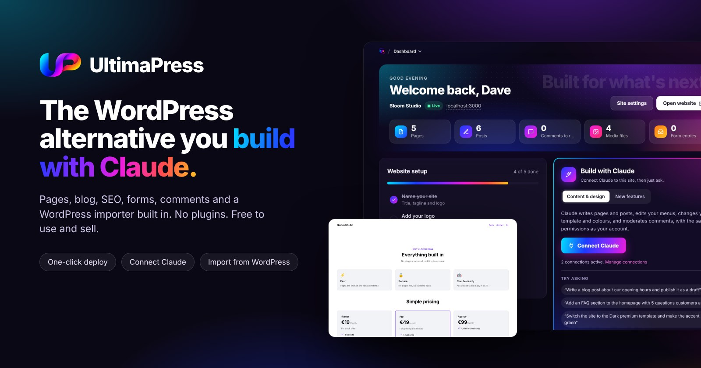
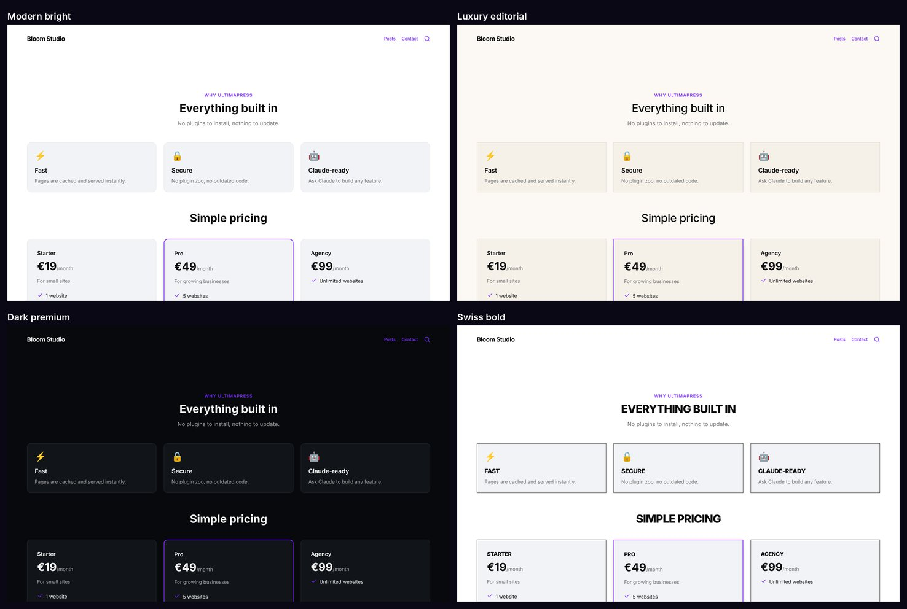
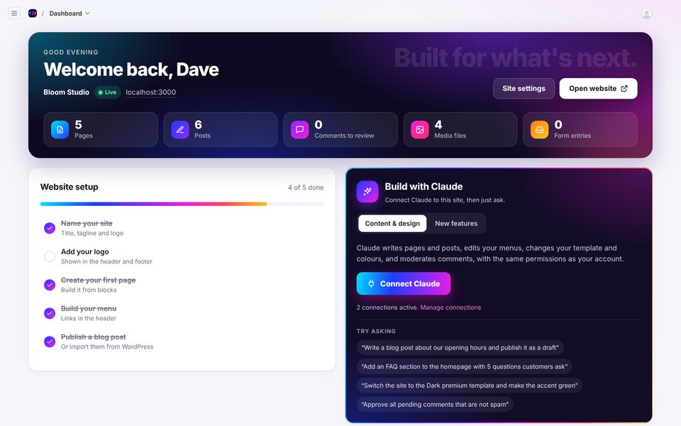
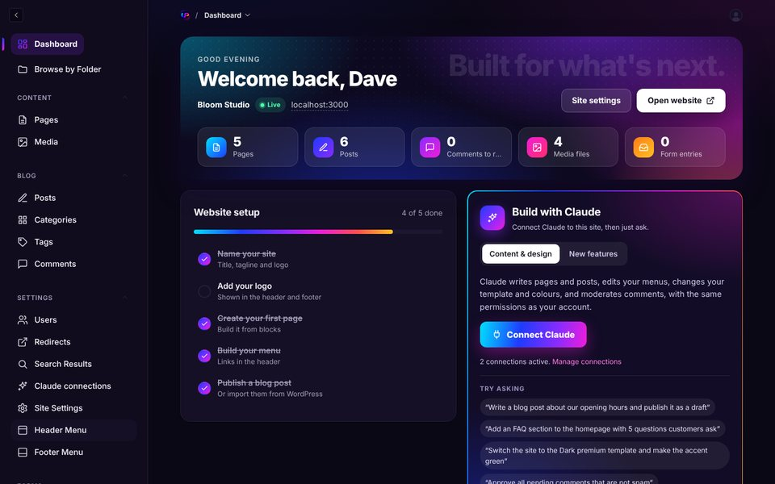
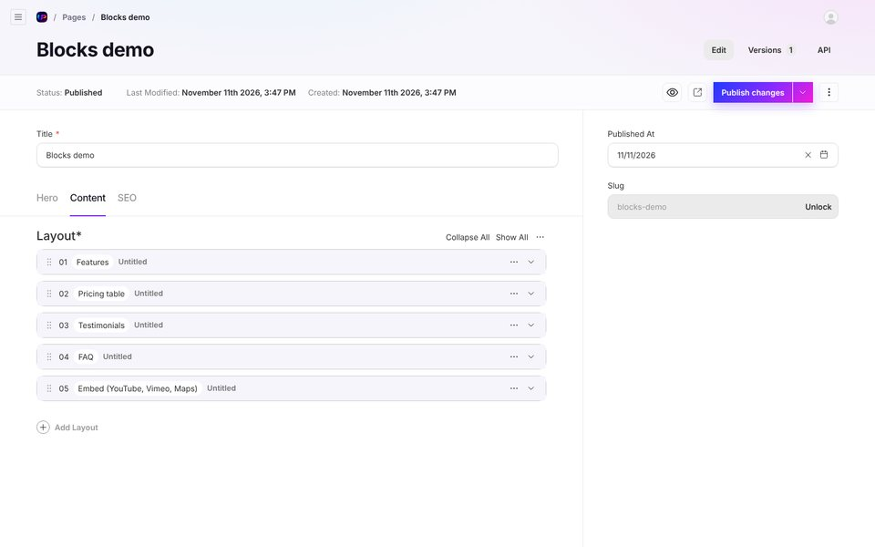
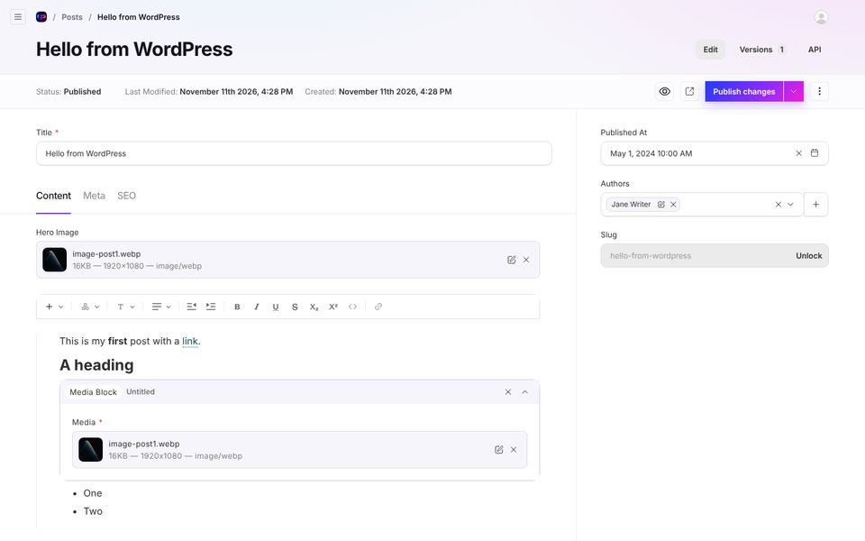
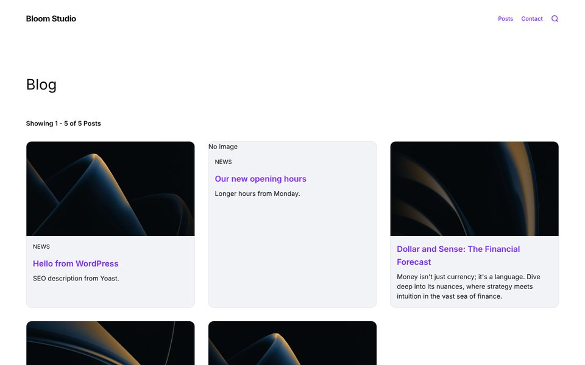
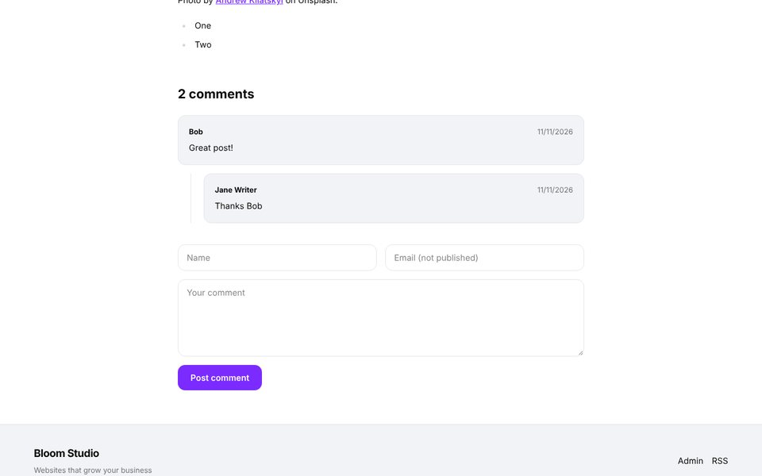
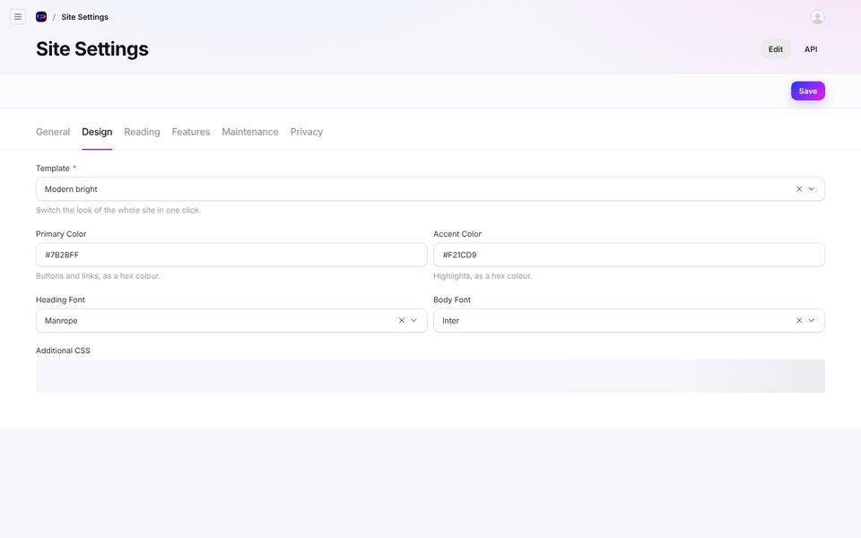
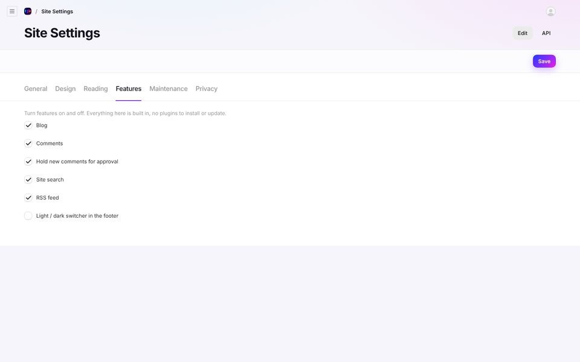

<p align="center">
  
</p>

<h1 align="center">UltimaPress</h1>

<p align="center">
  <b>The WordPress alternative you can ask Claude to build anything on.</b><br>
  Free to use, modify and sell. No plugins to install, nothing to keep patching.
</p>

<p align="center">
  <a href="https://www.hostinger.com/mrwebvps"></a>
</p>

<p align="center">
  
  
  
  
  
</p>

---

Pages, a blog, menus, SEO, forms, comments, roles and a WordPress importer are all built in.
There are no plugins to install and nothing to keep patching. When you need something new,
open the project in Claude and describe it; Claude builds it straight into your site.

## Contents

- [What's included](#whats-included)
- [Deploy in one click](#deploy-in-one-click)
- [Install from the files (customised sites)](#install-from-the-files-customised-sites)
- [Four looks, one click to switch](#four-looks-one-click-to-switch)
- [Feature tour](#feature-tour)
- [UltimaPress vs WordPress](#ultimapress-vs-wordpress)
- [Moving from WordPress](#moving-from-wordpress)
- [Build anything with Claude](#build-anything-with-claude)
- [Use it for clients](#use-it-for-clients)
- [Hosting guide](#hosting-guide)
- [Updates, backups and restoring](#updates-backups-and-restoring)
- [Troubleshooting](#troubleshooting)
- [FAQ](#faq)
- [Roadmap](#roadmap)
- [Local development](#local-development)
- [Requirements](#requirements)
- [Credits and licence](#credits-and-licence)

## What's included

- **Page builder** with blocks: hero, content, media, features, pricing tables, testimonials,
  gallery, FAQ (with search-engine markup), call to action, forms, video and map embeds, and
  post archives. Live preview, drafts, scheduled publishing and revisions.
- **Blog**: posts, categories, tags, authors, excerpts, sticky posts, featured images,
  related posts, category, tag and author archives, RSS feed.
- **Comments** with moderation, threaded replies and built-in spam protection.
- **4 switchable templates** (Modern bright, Luxury editorial, Dark premium, Swiss bold) plus
  your own colours, Google fonts, logo, site icon and additional CSS.
- **Menus** for the header (with drop-downs) and footer.
- **SEO**: meta titles and descriptions, social images, sitemaps, redirects, robots control.
- **Forms** with email notifications and saved submissions.
- **Site search.**
- **Roles**: Administrator, Editor, Author.
- **Settings** like WordPress: site title and tagline, homepage (a page or latest posts),
  posts per page, language, timezone, feature switches, maintenance mode, privacy page.
- **Import from WordPress**: posts, pages, media, categories, tags, authors, comments,
  featured images and Yoast or Rank Math descriptions. Old WordPress URLs redirect to the new
  ones, so you keep your rankings.
- **Export** all content as one file, plus nightly database and media **backups**.
- **One-click deploy** with Docker and automatic HTTPS.

## Deploy in one click

1. Click **Deploy on Hostinger** above, or get a VPS through **[my link](https://www.hostinger.com/mrwebvps)** (KVM 2 is plenty) and choose **Ubuntu 24.04 with Docker**.
2. In hPanel open **Docker Manager > Compose from URL** and paste:
   `https://raw.githubusercontent.com/mrwebtv/ultimapress/main/docker-compose.yml`
3. Optionally set `DOMAIN` (pointed at the VPS IP for automatic HTTPS), `POSTGRES_PASSWORD`, and the `SMTP_*` variables for emails. Then deploy.
4. Wait 2 to 3 minutes, open `https://yourdomain.com/admin` (or `http://VPS-IP/admin`) and create your administrator account.

Secrets are generated automatically on first start and kept on the server. Backups run every night. To update later, click **Update** in Docker Manager.

The dashboard then walks you through naming your site, choosing a template and building your menu.

## Install from the files (customised sites)

Once you have changed UltimaPress with Claude, deploy your own version instead of the ready-made one. On a VPS (a **[Hostinger VPS](https://www.hostinger.com/mrwebvps)** with Ubuntu works well):

```bash
git clone https://github.com/<you>/<your-site>.git   # or upload and unzip ultimapress.zip
cd <your-site>
./install.sh
```

The installer sets up Docker if needed, asks for your domain, builds the site from your files and gets your HTTPS certificate.

## Four looks, one click to switch



Modern bright, Luxury editorial, Dark premium and Swiss bold. Pick one in
**Site Settings > Design** and the whole site switches instantly. Then set your own primary
and accent colours, heading and body fonts, logo and site icon. Everything you add later,
including features Claude builds for you, follows the template automatically.

## Feature tour

### A dashboard that tells you what to do next





Your website and its status, live counts (pages, posts, comments waiting for review, media,
form entries), quick actions, recently edited content, a setup checklist with a progress
bar, Build with Claude, the WordPress importer and a one-click export, right where you log
in.

### The Spine

The menu is not a sidebar. It is the Spine: a thin glowing line down the left edge with one
node per section (Dashboard, Write, Media, Design, Grow, Build, Your features). Hover a node
and its panel blooms out; hover a page or post in the panel and a live preview of it appears.
Badges show what needs you, such as comments waiting. Your profile, settings, the website
link and the Bright / Dark switch sit fixed at the bottom. While you edit a page it fades
back so you can focus, and on a phone it becomes a single UP button. Every feature you build
with Claude appears under Your features automatically. The admin opens in Dark mode.

### Page builder



Build pages from blocks and drag them into order. Every page has a hero section, a content
area and an SEO tab. Live preview shows mobile, tablet and desktop while you type, drafts
autosave, and you can schedule a page to publish later or roll back to an earlier version.

| Block | What it's for |
| --- | --- |
| Content | Text in one, two or three columns, with optional buttons |
| Media | A full-width image or video |
| Features | A grid of benefits with icons |
| Pricing table | Up to four plans, with a highlighted favourite |
| Testimonials | Quotes with name, role, photo and star rating |
| Gallery | An image grid in two, three or four columns |
| FAQ | Questions that expand, plus FAQ markup for Google |
| Call to action | A highlighted message with buttons |
| Form | Any form you build in the Forms section |
| Embed | Paste a YouTube, Vimeo, Loom or Google Maps link |
| Archive | Your latest posts, a category, or hand-picked posts |

### A full writing editor



Headings, lists, quotes, alignment, indentation, links, images and media blocks, with live
preview on mobile, tablet and desktop.

### Blog and comments



Posts have categories, tags, authors, an excerpt, a featured image and related posts. Pin
important posts to the top, turn comments on or off per post, and readers get category,
tag and author archives plus an RSS feed at `/feed.xml`.



Comments are threaded, held for approval by default, and protected from spam bots without
a captcha. Commenters' email addresses are never shown publicly.

### Settings you already know



**Site Settings** has the tabs you'd expect from WordPress:

| Tab | What's in it |
| --- | --- |
| General | Site title, tagline, logo, site icon, language, timezone, date format |
| Design | Template, colours, fonts, additional CSS |
| Reading | Homepage (a static page or latest posts), posts per page, hide from search engines |
| Features | Switch the blog, comments, moderation, search, RSS and the light/dark switcher on or off |
| Maintenance | Show visitors a "back soon" page while you work; logged-in users still see the site |
| Privacy | Choose your privacy policy page, linked in the footer |



### Roles

| Role | Can do |
| --- | --- |
| Administrator | Everything, including users, settings, import and export |
| Editor | All pages, posts, media, categories, tags and comments |
| Author | Write and edit their own posts, upload media |

The first account created on a new site is always the administrator.

### SEO built in

Meta titles and descriptions with a live Google preview, social sharing images, automatic
sitemaps at `/sitemap.xml`, a `robots.txt` that follows your Reading settings, FAQ markup,
and a Redirects section for moved pages (301 or 302). No SEO plugin needed.

### Forms

Build contact forms, quote requests or sign-ups with text, email, number, select,
checkbox, country and message fields. Every submission is saved in the admin, and you can
send email notifications to yourself and a confirmation to the visitor.

## UltimaPress vs WordPress

| | WordPress | UltimaPress |
| --- | --- | --- |
| Page builder | Plugin (Elementor, Divi...) | Built in |
| SEO | Plugin (Yoast, Rank Math) | Built in |
| Forms | Plugin | Built in |
| Redirects | Plugin | Built in |
| Backups | Plugin or host | Built in, nightly |
| Plugin updates to keep up with | Many, every week | None |
| Plugin security holes | The most common way WordPress sites get hacked | No third-party plugins |
| Adding a custom feature | Find a plugin, or hire a developer | Ask Claude |
| Admin | Familiar, crowded | Clean, only what you use |
| Runs on shared hosting | Yes | No, needs a VPS with Docker |
| Plugin and theme marketplace | Huge | None: you build exactly what you need |

UltimaPress is not a WordPress clone and does not run WordPress plugins. It gives you what
most sites use plugins for, built in, and Claude for everything else.

## Moving from WordPress

1. In WordPress, go to **Tools > Export**, choose **All content** and download the file.
2. In UltimaPress, log in as administrator. On the dashboard, under **Import from
   WordPress**, choose the file and click **Start import**. Keep the tab open until it
   finishes.
3. Check the report. It lists how many posts, pages, media files, categories, tags,
   authors, comments and redirects came across, and anything that needs attention.

**What comes across**

- Posts and pages, published or draft, with their original publish dates
- Text formatting, headings, lists, links and images inside the content
- Featured images and all media in the Media Library
- Categories, tags and sticky posts
- Authors, as Author accounts (they set their password with "Forgot password")
- Approved comments, including replies
- Excerpts, plus Yoast or Rank Math SEO titles and descriptions
- A 301 redirect from every old WordPress address to its new one, so links and Google
  rankings keep working

**What doesn't**

- Page builder layouts (Elementor, Divi and similar) arrive as plain content; rebuild those
  pages with blocks
- Shortcodes are removed
- Plugin data such as WooCommerce products, form entries or membership levels
- Theme settings and widgets

Running the import twice is safe: anything that already exists is skipped.

## Build anything with Claude

### Connect Claude to your site (no code)

On the dashboard, open **Build with Claude** and click **Connect Claude**. Copy the address
it gives you, then in Claude go to **Settings > Connectors > Add custom connector** and paste
it. Now just ask, in any chat:

- "Write a blog post about our new opening hours and save it as a draft."
- "Add an FAQ section to the homepage with five questions customers ask."
- "Switch the site to the Dark premium template and make the accent green."
- "Approve all pending comments that aren't spam."

The connection works with your permissions: an Author's connection can write posts but
can't change pages or settings. Your site needs its domain with HTTPS for Claude to reach
it. See or remove connections under **Settings > Claude connections**. Using Claude Code?
The same card gives you a one-line command instead.

### Add new features (Claude Code)

UltimaPress is one clean codebase that Claude can read from end to end. Instead of adding
another plugin, Claude changes the site itself. Open the project folder in Claude and ask
for what you need.

| Ask Claude | What you get |
| --- | --- |
| "Add an events section with dates, a venue and a booking button." | An Events collection in the admin, an events page and a page per event |
| "Add a team block with photos, roles and LinkedIn links." | A new block you can drop on any page |
| "Show a cookie banner that links to the privacy page." | A banner that remembers each visitor's choice |
| "Let visitors book a call, with an email to me for each booking." | A booking form, saved bookings and email notifications |
| "Add a services section, each with its own page and price." | A Services collection, list page and service pages |
| "Make the site available in French and English." | Translated fields and a language switcher |
| "Add a reading time and table of contents to blog posts." | Both, on every post, automatically |
| "Add a portfolio with filters by category." | A filterable portfolio page |
| "Send me a weekly email listing new comments." | A scheduled job that sends the summary |
| "Add a members-only area." | Login for members and pages only they can see |

`CLAUDE.md` tells Claude how the project is organised and the rules that keep your site
working, for example that every database change ships with a migration, that new features
use the theme colours so they match every template, and that every feature has proper
permissions.

**No GitHub account, no server access.** Everything happens between your admin and Claude:

1. In the admin, open **Build > Site code** and click **Download the code**. You get a zip of
   your own site. Unzip it.
2. Open the folder in Claude Code and ask for the feature.
3. Say **"put it live"**. Claude sends the new version to your site, and you confirm it in
   Site code with your password. (Or zip the folder and drop it on that page.)

Your content is backed up first. The new version is built and started next to the live one,
and only takes over once it answers. If the build fails or it does not start, your site
keeps running the version it had, and the page shows what went wrong so you can hand it back
to Claude. You can also switch back to the previous version, or to the official UltimaPress,
at any time.

To let Claude send updates, create a deploy key on the Site code page and paste the line it
shows into Claude Code once. A deploy key can only deliver an update: nothing goes live
without your password.

Good to know:

- Building needs more memory than running. If an update stops during "Building the site",
  the server is probably too small: use a VPS with at least 4 GB of memory.
- Your own versions are kept on the server's storage: allow about 3 GB of free disk space.
- While your own version is live, **Update** in Docker Manager does not replace it. Switch
  back to the official version in Site code to get a newer UltimaPress.
- Prefer to keep your code on GitHub or on the server itself? See
  [Install from the files](#install-from-the-files-customised-sites): after a change, run
  `./update.sh` on the server.

## Use it for clients

UltimaPress is free for client work: you can use it, change it, rebrand the admin and
charge for the sites you build. Your clients' sites don't need to credit UltimaPress.

- **Rebrand**: replace the logo and icon in `src/components/admin/` and the admin shows
  your brand. Each client's own logo goes in their Site Settings.
- **Hand over**: create the client an Editor account so they manage content without
  touching settings or users. Keep the Administrator account yourself.
- **Customise**: build the client's extra features with Claude, deploy them with
  `./install.sh` on their VPS, and keep each client's site in its own private Git repo.
- **Recurring income**: offer hosting, updates, backups and small changes as a monthly
  care plan. Backups and updates take one command each.
- **Migrate WordPress clients**: the importer moves their content and keeps their Google
  rankings with automatic redirects, and they lose the plugin update headaches.

## Hosting guide

UltimaPress needs a VPS (a virtual server) with Docker. Shared hosting won't run it.

| Site | Suggested Hostinger VPS |
| --- | --- |
| A business site or blog | KVM 1 or KVM 2 |
| Several sites, or one busy site with lots of media | KVM 2 |
| An agency running many client sites | KVM 4 or above |

Get one through **[my Hostinger link](https://www.hostinger.com/mrwebvps)** and choose
**Ubuntu 24.04 with Docker** as the operating system.

**Pointing your domain**

1. In your domain's DNS settings, create an **A record** for `@` pointing at the VPS IP
   address. Add another for `www` if you want it.
2. Wait for DNS to update (usually minutes, sometimes a few hours).
3. Set `DOMAIN` to your domain in Docker Manager (or `.env`) and redeploy. The HTTPS
   certificate is issued and renewed automatically.

**Sending email**

Password resets and form notifications need an email service. Set these variables and
redeploy: `SMTP_HOST`, `SMTP_PORT` (587 or 465), `SMTP_USER`, `SMTP_PASS` and
`SMTP_FROM_ADDRESS`. Any SMTP service works, including Hostinger email, Gmail with an app
password, Brevo or Resend. Without them, emails are written to the server log instead.

## Updates, backups and restoring

| Task | How |
| --- | --- |
| Update the one-click install | **Update** in Hostinger Docker Manager |
| Update a customised site | `./update.sh` (backs up first, pulls your latest code, rebuilds) |
| Automatic backups | Every night at 03:00 (database) and Sundays (media), kept 14 days |
| Back up now, to files you can download | `./scripts/backup.sh` (saved in `backups/`) |
| Restore a backup | `./scripts/restore.sh backups/<date>` |
| Export all content as one file | Dashboard > **Download export** |
| See what the server is doing | `docker compose logs -f app` |

Database changes in new versions are applied automatically when the site starts, so there
is no separate "update database" step.

**Example: restore yesterday's backup**

```bash
ls backups/                                  # find the backup you want
./scripts/restore.sh backups/2026-11-10_030000
```

You'll be asked to type `RESTORE` to confirm, because this replaces the current content.

## Troubleshooting

**The site doesn't load after deploying.** The first start takes 2 to 3 minutes. Check
progress with `docker compose logs -f app` and wait for "Ready".

**HTTPS isn't working.** Check that your domain's A record points at the VPS IP, that
`DOMAIN` is set without `https://`, and that ports 80 and 443 are open in the VPS firewall.
The certificate is issued on the first visit once DNS is correct.

**I see a certificate warning on the IP address.** That's expected without a domain: the
site uses a self-signed certificate. Set `DOMAIN` for a trusted one.

**Emails aren't arriving.** Check the `SMTP_*` variables, then look in the logs for email
errors. Many providers need an app password rather than your normal password.

**I forgot the admin password.** Use "Forgot password" on the login page. Without email
set up, the reset link appears in `docker compose logs app`.

**A page shows old content.** Pages are cached for speed and refresh automatically after
you publish. If something still looks stale, publish the page again.

**An old WordPress URL shows a 404.** New redirects take effect within a minute. Check
the address under **Settings > Redirects** in the admin.

**Changes I made with Claude don't show on the live site.** Run `./update.sh` on the
server so the site is rebuilt from your files.

## FAQ

**Is it really free?**
Yes. UltimaPress is free to use. You pay only for your server and domain.

**Can I use WordPress plugins?**
No. UltimaPress isn't WordPress. The things most sites use plugins for are built in, and
for anything else you ask Claude to build it.

**Do I need to know how to code?**
No to run a site: everything is managed from the admin. To add new features you describe
them to Claude in plain English.

**Does it run on shared hosting?**
No. It needs a VPS with Docker. A small Hostinger KVM plan is enough.

**Can I sell sites built with it?**
Yes. You can build and sell sites for clients, and change the code as much as you like.

**Can I make videos or courses about it?**
Yes, gladly. The licence asks one thing: say out loud that it's "UltimaPress by Mr Web" and
put that credit with a link to this repo in the description. See `LICENSE`.

**Can I move my WordPress site?**
Yes, with the built-in importer. Posts, pages, media, categories, tags, authors, comments
and SEO descriptions come across, with redirects from your old URLs.

**Will I lose my Google rankings?**
The importer creates a 301 redirect from every old URL to its new address, which is what
search engines need to carry rankings over.

**Is it fast?**
Pages are rendered once and served from cache, and there are no plugins adding scripts to
every page.

**Is it secure?**
There are no third-party plugins, which is where most WordPress hacks come from. The
database is never exposed outside the server, and every part of the admin has role-based
permissions.

**How do updates work?**
One click in Hostinger Docker Manager, or `./update.sh` for customised sites. Database
changes apply automatically.

**Can I have more than one site on a VPS?**
Yes. Deploy each site in its own Docker Manager project, using different `HTTP_PORT` and
`HTTPS_PORT` values, or put them behind a shared proxy.

**What languages does it support?**
Set your site language in Site Settings. For a multilingual site, ask Claude to add
translations.

**Where are my files and data?**
On your own server, in Docker volumes: the database, uploaded media and backups. You own
everything.

**Can I get my content out again?**
Yes. Download an export of all content from the dashboard at any time, and back up the
database and media with one command.

## Roadmap

- Shop edition: products, cart and Stripe checkout
- Membership edition: paid members-only content
- Booking edition: services, staff calendars and reminders
- More templates and blocks
- One-click staging site for testing changes before they go live

## Local development

```bash
cp .env.example .env    # set DATABASE_URL to a local Postgres, plus PAYLOAD_SECRET
pnpm install
pnpm dev                # http://localhost:3000
```

Useful commands:

```bash
pnpm generate:types                  # after changing collections or fields
pnpm payload migrate:create <name>   # every database change needs a migration
pnpm generate:importmap              # after adding admin components
npx tsc --noEmit                     # type check
```

## Requirements

- Production: a VPS with Docker and Compose v2, 2 GB RAM minimum (a [Hostinger KVM 2](https://www.hostinger.com/mrwebvps) or bigger recommended).
- Development: Node.js 22, pnpm 10, PostgreSQL 15 or newer.

## Credits and licence

UltimaPress is built on [Payload CMS](https://payloadcms.com) with a ton of improvements,
making it the perfect foundation for any project you have in mind. Payload and Next.js are
MIT licensed; see `NOTICES.md`.

UltimaPress is free to use under the UltimaPress Licence: build and sell sites with it
freely, and credit "UltimaPress by Mr Web" in any video, post, course or product about it.
See `LICENSE`. The UltimaPress name and logo are covered in `TRADEMARKS.md`.

---

<sub>No warranty, no liability. UltimaPress is free software, provided "as is" under the UltimaPress Licence. You run it on your own server at your own risk. To the fullest extent permitted by law, David Garray, Mr Web and the associated business Everything Custom-built Limited cannot be held liable for any loss or damage that comes from installing or using it, including a website that breaks, goes offline, is hacked or loses data, failed updates or features, lost revenue, and claims from your own clients or visitors. Backups, security, updates, your content and the laws that apply to your website are your responsibility. There is no obligation to provide support. Full terms: <a href="https://ultimapress.com/terms.html">ultimapress.com/terms.html</a>.</sub>
